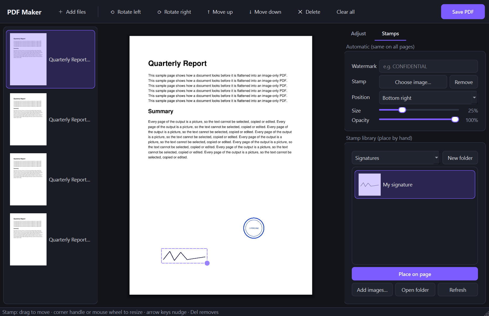

# PDF Maker

Turn Word documents, PDFs and images into a **flattened PDF**: every page is a picture, so the text cannot be selected, copied or edited.

**[Download for Windows](https://github.com/Himmatilloxon/PDFMaker/releases/latest/download/PDFMaker-windows.zip)** · [Website](https://himmatilloxon.github.io/PDFMaker/)



## Features

- **Inputs**: Word (`.docx`, `.doc`, `.rtf`, `.odt`), PDF, and images (`.png`, `.jpg`, `.bmp`, `.tif`, `.webp`). Mix them freely; they are merged into one PDF.
- **Page management**: reorder by dragging, rotate, delete.
- **Quality presets**: from a small 150 DPI file to lossless 300 DPI.
- **Image adjustments**: colour, grayscale or black-and-white; brightness; contrast; crop edges.
- **Clean page background**: turns grey, yellow or shadowed paper white. Useful for scans and phone photos of documents.
- **Watermark and automatic stamp**: diagonal text and/or an image such as a logo, put in the same place on every page.
- **Stamps placed by hand**: drop a seal or signature on any page, drag it where you want and resize it. Each page keeps its own stamps.
- **Stamp library**: your stamp images are kept in `Documents\PDFMaker Stamps`, one folder per type (for example `Signatures`, `Seals`). Each stamp remembers the size you last used.
- **Live preview** of every setting before you save.

## How to use

1. Download `PDFMaker-windows.zip` from the link above and unzip it anywhere.
2. Open the `PDFMaker` folder and run `PDFMaker.exe`. Keep the `_internal` folder next to it.
3. Drag files onto the window, or click **Add files**.
4. Arrange the pages in the list on the left. Select a page to preview it.
5. Pick the quality and any adjustments in the panel on the right.
6. Click **Save PDF** (Ctrl+S).

### Placing stamps by hand

1. Open the **Stamps** tab. Pick a folder, or create one with **New folder**.
2. Click **Add images…** to copy your stamp images into that folder. PNG files with a transparent background look best.
3. Select the page you want, then drag a stamp from the list onto it, or double-click the stamp.
4. Drag the stamp to move it. Drag the round corner handle, or use the mouse wheel, to resize it. Arrow keys nudge it; `+` and `-` resize it; `Del` removes it.

Hand-placed stamps keep their own colours even when the page is set to grayscale or black-and-white. To rename, move or delete stamps in the library, click **Open folder** and do it in Explorer, then click **Refresh**.

Notes:

- The exe is not code-signed, so Windows SmartScreen may warn on first run. Choose **More info → Run anyway**.
- Word files need Microsoft Word or LibreOffice installed. PDFs and images work without either.
- Password-protected PDFs are not supported.

### Shortcuts

| Action | Keys |
| --- | --- |
| Add files | Ctrl+O |
| Rotate left / right | Ctrl+L / Ctrl+R |
| Move page up / down | Ctrl+Up / Ctrl+Down |
| Delete selected pages | Del |
| Save PDF | Ctrl+S |

### Command line

```
python convert.py report.docx appendix.pdf scan.jpg -o out.pdf --dpi 200 --quality 88 --gray --clean
```

`--quality 0` writes lossless PNG pages.

## How it is made

Two Python files:

- `convert.py` is the engine and the command-line tool.
- `app.py` is the desktop window, which calls the engine.

The pipeline for each file:

1. **Word → PDF.** Microsoft Word is driven through COM (`pywin32`) for the best fidelity. If Word is missing, LibreOffice is used instead.
2. **PDF page → image.** [PyMuPDF](https://pymupdf.readthedocs.io/) renders each page in-process at the chosen DPI. Images are loaded with Pillow and fitted onto an A4 page.
3. **Image processing.** Pillow and NumPy apply crop, background cleaning, brightness, contrast, colour mode and the watermark. Background cleaning estimates the paper colour around each pixel and divides it out, so uneven lighting flattens to white.
4. **Images → PDF.** PyMuPDF writes one image per page as JPEG, or PNG for lossless and black-and-white. The page keeps its original physical size.

The window is built with [PySide6](https://doc.qt.io/qtforpython-6/) (Qt). Conversion runs on a background thread so the window stays responsive and the job can be cancelled. The exe is packaged with [PyInstaller](https://pyinstaller.org/).

The first version was a script that chained LibreOffice, Ghostscript and Poppler. This version replaced those with PyMuPDF, which removed two external installs and made PDF and image input possible. The rewrite was done with the help of Claude Code.

## Build from source

Requires Python 3.11 or newer on Windows.

```
pip install -r requirements.txt
python app.py            # run the app
python test_convert.py   # engine self-check
build.bat                # builds dist\PDFMaker\PDFMaker.exe
```

## License

[AGPL-3.0](LICENSE). The app bundles PyMuPDF, which is AGPL-licensed, so the whole project is distributed under the same terms.
